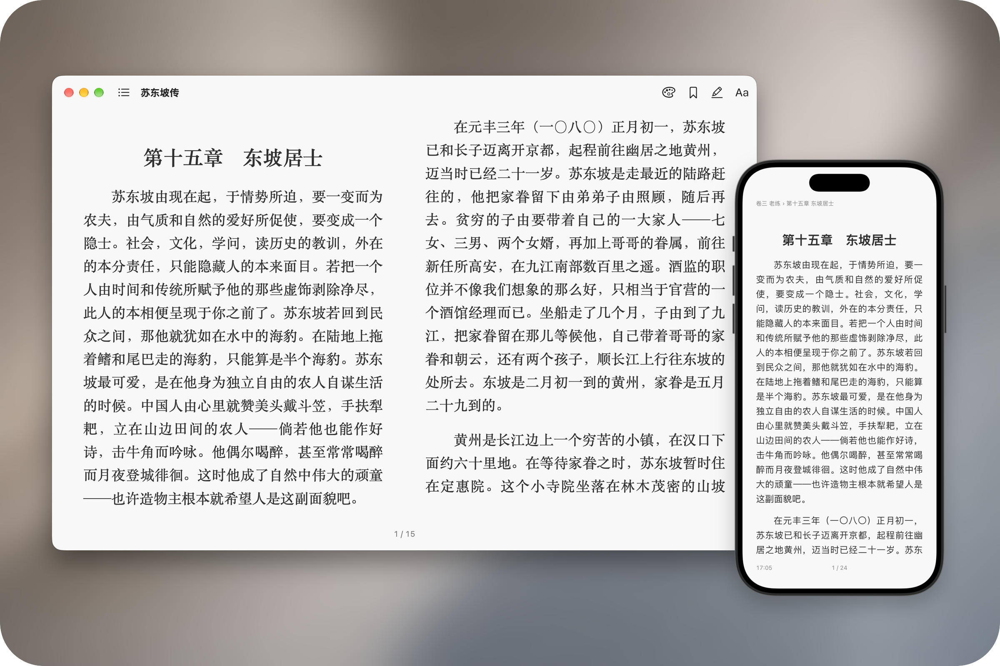

# Rede

一款开源、轻量、现代化的电子书阅读器。

专为 macOS / iOS 中文阅读设计，通过 iCloud 同步。

## 预览

## 功能

- 书籍管理：导入和导出书籍、批量管理书籍、查看书籍元信息
- 阅读样式：切换字体、调节行距/段距/页边距、切换单栏/双栏、深色模式/浅色模式、进度条
- 内容标注：搜索、书签、高亮、笔记功能

## 安装 Rede

**macOS**

> 需要 macOS 版本 >= 26.0

1. 从 [Releases](https://github.com/qyangcv/Rede/releases/latest) 下载最新的 `Rede.dmg`
2. 打开 dmg，将 Rede 拖入 “应用程序” 文件夹

**iOS** 

> 需要 iOS 版本 >= 26.0

1. 在 App Store 安装 [TestFlight](https://apps.apple.com/app/testflight/id899247664)
2. 在 iOS 上打开 [TestFlight 链接](https://testflight.apple.com/join/UvDG6ykV)，安装 Rede 测试版

## 数据与隐私

Rede 的云同步功能不会收集您的任何信息，包括：

- 无账号体系，书籍、分类、阅读进度和标注信息仅保存在设备本地与个人 iCloud 私有数据库
- 不包含任何数据统计、行为分析或遥测上报，不收集任何个人信息
- 除可选的 iCloud 同步外，仅在按需下载开源字体和 macOS 版检查更新时连接 GitHub

## 已知局限

- 支持 EPUB、AZW3、MOBI、TXT 格式，不支持 PDF、 DRM 加密书籍、固定版式（FXL / Print Replica）书籍、漫画或画册
- 导入书籍时，Rede 会将 EPUB、AZW3、MOBI、TXT 统一转化为 EPUB 格式，导出书籍也统一为 EPUB 格式。
- 仅支持横排中文阅读，不支持繁体中文、竖排文字，不支持垂直方向滚动翻页
- 仅支持 iCloud 同步，不支持 WebDAV、OPDS 和 Calibre

## 开发记录

- [x] 支持 AZW3 / MOBI / TXT 格式（2026.11.28）

## 致谢

- [ReadiumCSS](https://github.com/readium/css)
- [ZIPFoundation](https://github.com/weichsel/ZIPFoundation)
- [Kanna](https://github.com/tid-kijyun/Kanna)
- [Sparkle](https://github.com/sparkle-project/Sparkle)
- [libmobi](https://github.com/bfabiszewski/libmobi)
- [uchardet](https://www.freedesktop.org/wiki/Software/uchardet/)
- [Legado](https://github.com/LegadoTeam/legado)